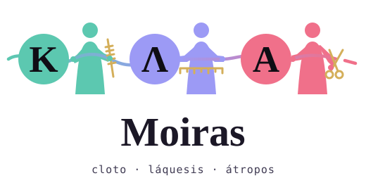

<p align="center">
  <picture>
    <source media="(prefers-color-scheme: dark)" srcset="assets/logo-wordmark-dark.svg">
    
  </picture>
</p>

# Moiras

Plugin para Claude que faz triagem de issues do Jira com Slack e um knowledge do time: coleta o que foi pedido, classifica cada issue e propõe soluções, com a decisão sempre nas mãos de quem trabalha no projeto.

```
Cloto (coleta Jira e Slack) → Láquesis (classifica, acha duplicados) → Átropos (veredito e de 3 a 5 soluções com % de confiança)
```

## Sumário

- [Instalação](#instalação)
- [Uso](#uso)
- [Segurança](#segurança)
- [Documentação](#documentação)
- [Desenvolvimento](#desenvolvimento)
- [Teste real das skills de knowledge](#teste-real-das-skills-de-knowledge)

## Instalação

```
/plugin marketplace add eitri-tech/eitri-shopping-project-moiras
/plugin install moiras@moiras
```

**Outros agentes** (Codex, Cursor, Copilot, opencode, Antigravity etc.): use o [`npx skills`](https://github.com/vercel-labs/skills), que copia ou liga as skills na pasta de cada agente.

```bash
npx skills add eitri-tech/eitri-shopping-project-moiras --list                      # lista as sete skills
npx skills add eitri-tech/eitri-shopping-project-moiras -a codex -s moiras-triage   # instala uma skill num agente
```

O `npx skills` copia só a pasta de cada skill: `scripts/memory.ts`, `scripts/knowledge.ts` e `scripts/config.ts` ficam em `plugins/moiras/scripts` e não vão junto. As skills chamam esses scripts por `${CLAUDE_PLUGIN_ROOT}`, variável que só o Claude Code define. Por isso, mantenha um clone do repositório e diga ao agente que `${CLAUDE_PLUGIN_ROOT}` é `<clone>/plugins/moiras`. Jira e Slack precisam de conectores no agente escolhido.

Precisa do Jira e do Slack conectados ao Claude (conectores do claude.ai ou servidores MCP próprios): o plugin não traz servidor MCP. Os scripts rodam em Node LTS, sem dependências.

## Uso

Rode `/moiras:moiras-init` no projeto onde vai rodar: ela pergunta o que falta (usa os conectores só para ler e propor, como os IDs do Slack), mostra o arquivo inteiro e cria o `.moiras/sources.json` depois do seu "sim". Nunca sobrescreve um existente, e você pode editar o arquivo à vontade; `/moiras:moiras-init --check` valida. Hoje Jira e Slack são o foco, mas o arquivo aceita blocos de outras fontes. Um exemplo enxuto, com os endereços (caminhos relativos à pasta que contém `.moiras/`; o modelo completo está em `plugins/moiras/config/sources.example.json`):

```json
{
  "jira": { "site": "example.atlassian.net", "epic": "PROJ-100", "project_end": "2026-12-15" },
  "slack": {
    "people": [{ "name": "Fulano", "id": "U0123456789" }],
    "channels": [{ "name": "#proj-squad", "id": "C0123456789" }]
  },
  "knowledge": [
    { "name": "local", "scope": "local", "dir": ".moiras/knowledge" },
    { "name": "team", "scope": "group", "repository": "git@github.com:<org>/team-knowledge.git", "dir": "../team-knowledge" }
  ],
  "index": {
    "repositories": [
      { "name": "acme-shop-checkout", "path": "../acme-shop-checkout", "url": "https://github.com/<org>/acme-shop-checkout", "owner": "Squad Checkout" }
    ]
  }
}
```

`repository` é o remoto git do knowledge compartilhado (privado, criado do template) e `url` é o endereço do repositório de código; nenhum dos dois leva credencial. Agências, interações, auditores, memória e relatórios são opcionais; o exemplo completo está no arquivo. Depois:

| Comando | O que faz |
|---|---|
| `/moiras:moiras-init` | Cria o `.moiras/sources.json` conversando; nunca sobrescreve |
| `/moiras:moiras-triage PROJ-100` | Tria as issues sem responsável do épico. `--auto` roda sem perguntas (cron); `--full` reprocessa tudo |
| `/moiras:moiras-learn [PROJ-100] [--since AAAA-MM-DD]` | Aprende com as issues já concluídas do épico: propõe soluções, padrões e decisões e grava no knowledge local só o que você aprovar |
| `/moiras:moiras-index` | Gera o glossário a partir do código. Só lê os repositórios; grava no knowledge local depois do seu "sim" |
| `/moiras:moiras-audit [glossary\|criteria\|learnings]` | Revisa o knowledge e aplica só os ajustes aprovados |
| `/moiras:moiras-sync <nome>` | Traz o que foi mergeado nos knowledges compartilhados |
| `/moiras:moiras-publish <nome>` | Abre um PR com o que é novo no knowledge local |

Sem glossário nem critérios, a Láquesis usa categorias padrão (ou `unknown`), limita `confidence` a 0.3 e avisa `criteria-missing`: é esperado, não é erro.

## Segurança

- Só lê e sugere no Jira e no Slack; nada é escrito sem o "sim" à lista exata. A exceção são as interações opcionais da Cloto (reação no Slack, comentário curto no Jira), desligadas por padrão (`interactions.enabled`). Com elas ligadas, só a reação autorizada em `interactions.auto_types` roda no `--auto` sem o "sim"; comentário sempre pede aprovação.
- O knowledge fica fora deste repositório: local (`.moiras/knowledge/`, fora do git) ou em repositórios privados criados a partir de um template público. Nunca guarda cópia de código nem segredos.
- A memória das etapas é local, só de acréscimo, e guarda hash e metadados, nunca o texto bruto.
- `moiras-publish` sempre abre PR num branch novo: nunca faz push na principal, `force push` nem merge.

## Documentação

- [`plugins/moiras`](plugins/moiras): fluxo, knowledge, configuração, execução por cron e memória.

## Desenvolvimento

Ambiente: `nix develop` (ou `direnv allow`) entra num shell com Node, TypeScript, Python 3 e jq fixados pelo `flake.lock`. Sem Nix, instale `git`, `curl` e `jq` (`sudo apt install -y git curl jq`), o [nvm](https://github.com/nvm-sh/nvm) e rode `nvm install && nvm use` (lê o `.nvmrc`). O Node executa os `.ts` direto, sem build.

Checagens:

```bash
node --test plugins/moiras/scripts/*.test.ts   # testes de memória e de knowledge (node:test)
tsc -p tsconfig.json                           # tipos; no Nix já vem pronto
claude plugin validate plugins/moiras && claude plugin validate .
```

Sem Nix, o `tsc` precisa dos tipos do Node (`.direnv/` está no `.gitignore`):

```bash
mkdir -p .direnv/types/node
tmp=$(mktemp -d) && npm pack @types/node@24 --pack-destination "$tmp" --silent
tar -xzf "$tmp"/types-node-*.tgz -C .direnv/types/node --strip-components=1
npx -y -p typescript tsc -p tsconfig.json
```

Testar o plugin: `claude --plugin-dir plugins/moiras`; depois de editar arquivos, `/reload-plugins`. O script de memória também roda na mão; use uma pasta temporária para não gravar no projeto:

```bash
S=$PWD/plugins/moiras/scripts/memory.ts; cd "$(mktemp -d)"
echo '{"key":"jira:PROJ-1","content":{"a":1}}' | node $S record clotho   # change: new
node $S query clotho                                                  # último registro de cada chave
```

Onde mexer:

| O que | Onde |
|---|---|
| Contratos e regras de cada etapa | `plugins/moiras/skills/moiras-triage/stages/*.md` |
| Orquestração, modos e leitura e escrita do knowledge | `plugins/moiras/skills/moiras-triage/SKILL.md` |
| Configuração, aprendizado do histórico, auditoria, indexação, sincronização e publicação | `plugins/moiras/skills/moiras-{init,learn,audit,index,sync,publish}/SKILL.md` |
| Memória das etapas | `plugins/moiras/scripts/memory.ts` |
| Regras dos registros do knowledge (`hash`, `check`, `issues`, `plan`) | `plugins/moiras/scripts/knowledge.ts` |
| Criação e validação da configuração | `plugins/moiras/scripts/config.ts` |
| Modelo de configuração | `plugins/moiras/config/sources.example.json` |

Fluxo: branch a partir da `main`, checagens, commits em inglês no imperativo (`Add ...`, `Fix ...`) e PR com título curto e descrição curta em português (o que muda e como testar). Não use dados reais da empresa em nenhum arquivo: os exemplos são fictícios (empresa Acme, `acme-shop-checkout`, `PROJ-123`).

## Teste real das skills de knowledge

Roteiro para validar `moiras-index`, `moiras-audit`, `moiras-sync` e `moiras-publish` num projeto de verdade. Quase tudo escreve só em `.moiras/` (fora do git). As exceções são o arquivo temporário do passo 4 e o clone do knowledge do passo 6; só o passo 7 escreve no remoto, abrindo um PR.

1. Crie uma pasta de teste fora do repositório (ex.: `~/moiras-teste`) e rode `/moiras:moiras-init` (ou crie à mão um `.moiras/sources.json` mínimo; os caminhos são relativos à pasta que contém `.moiras/`). Comece com um repositório:

   ```json
   {
     "knowledge": [{ "name": "local", "scope": "local", "dir": ".moiras/knowledge" }],
     "index": { "repositories": [{ "name": "acme-shop-checkout", "path": "../acme-shop-checkout" }] }
   }
   ```

2. Abra o Claude nela com `claude --plugin-dir <clone>/plugins/moiras`; o `/help` lista as sete skills.
3. **Indexe** com `/moiras:moiras-index` (nada é gravado antes do "sim"). Confira com `node <clone>/plugins/moiras/scripts/knowledge.ts check .moiras/knowledge`: sem achados, `url` sem credencial, `local_path` relativo e nenhum trecho de código.
4. **Reindexe**: sem mudanças, volta `unchanged`. Para ver `changed`, crie um arquivo em `src/` do repositório, rode de novo, **responda "não" à gravação** e apague o arquivo. Prefira um clone descartável se o repositório tiver alterações suas.
5. **Audite** com `/moiras:moiras-audit glossary`: sem achados graves. Para ver o aviso de glossário velho, copie o arquivo, ponha um `indexed_at` de mais de 6 meses e rode de novo (ela só sugere `moiras-index`); **restaure a cópia antes do passo 7**.
6. **Sincronize**: acrescente em `knowledge` um item `{ "name": "team", "scope": "project", "repository": "<url-do-knowledge-privado>", "dir": "../moiras-knowledge-team" }` e rode `/moiras:moiras-sync team`. Ela pergunta antes de clonar; clone sujo ou divergente a faz parar.
7. **Publique** com `/moiras:moiras-publish team`: ela confere que o destino é o `repository` configurado e é privado, mostra a lista exata, copia só depois do "sim" e abre o PR do branch `moiras/index-<AAAA-MM-DD>` com o `gh` (sem ele, para e explica). Feche o PR e apague o branch se não quiser manter o glossário de teste.
8. **Triagem** (opcional): com Jira e Slack conectados, rode `/moiras:moiras-triage` e confira se a Láquesis cita `knowledge:local/glossary/...`.

Anote onde a skill perguntou o que a documentação não prevê, campos do glossário errados ou inventados e mensagens de erro, sem colar conteúdo de repositório ou de issue. Limpeza: apague a pasta de teste e o clone do knowledge.
