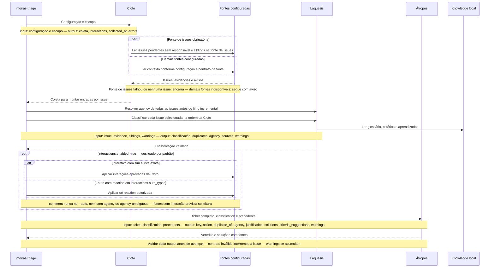
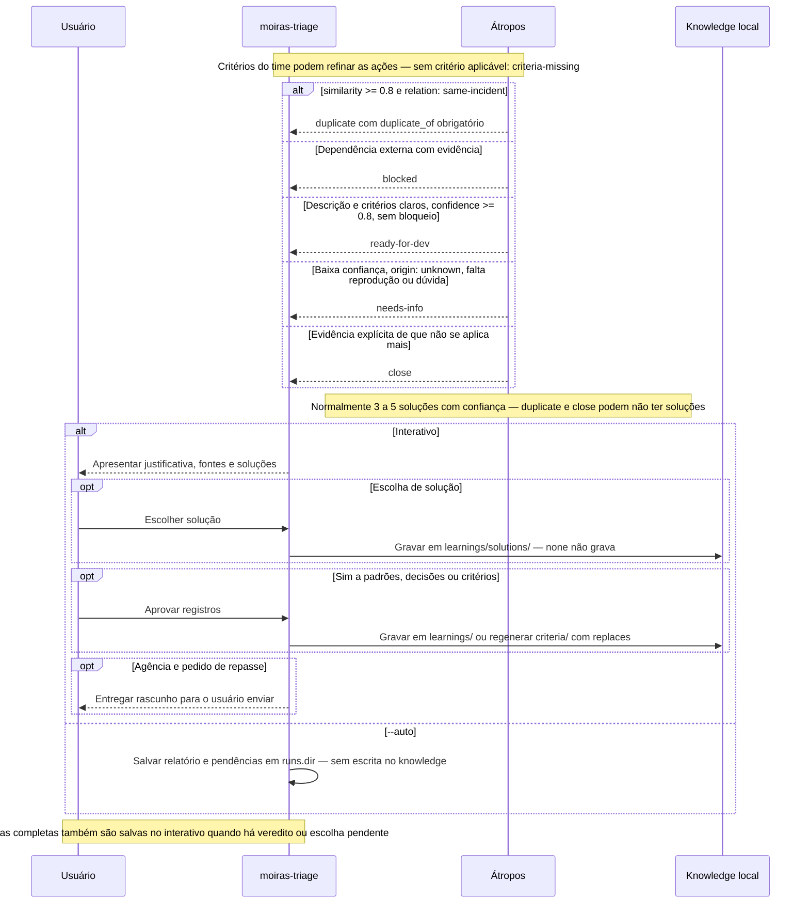
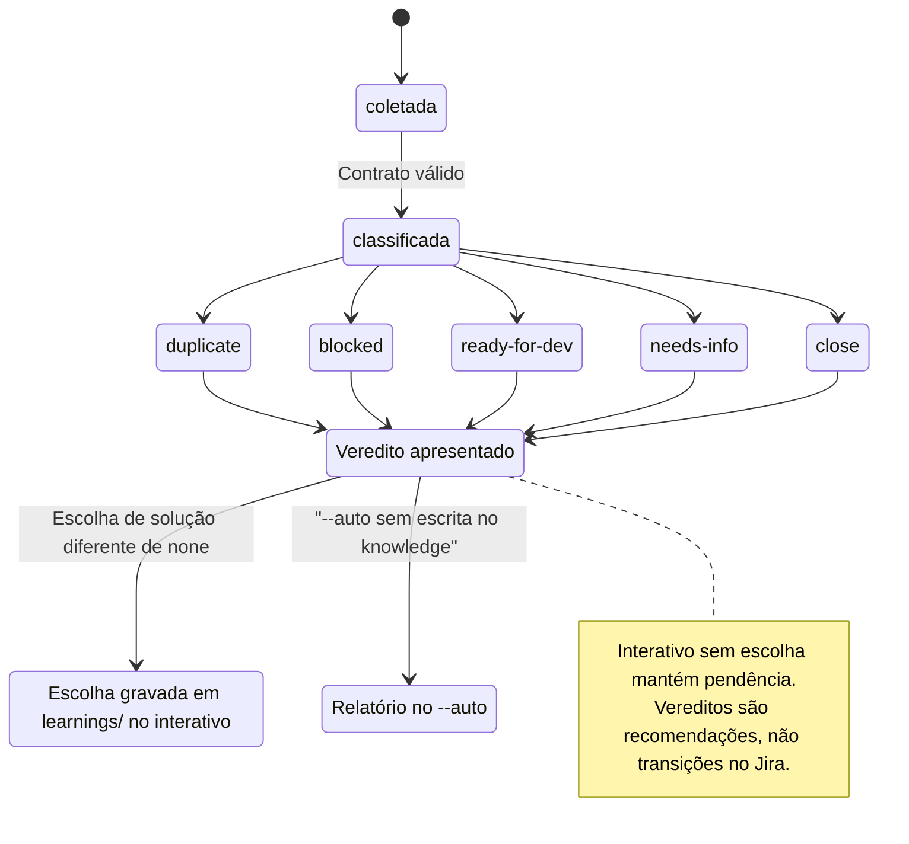
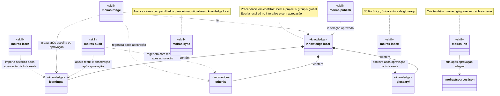
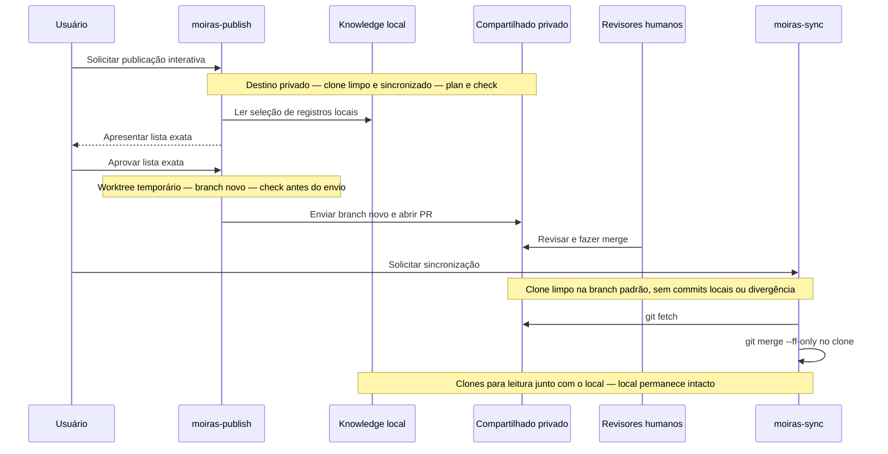

# Moiras

Plugin para Claude que faz triagem de issues do Jira usando um knowledge do time.

O nome vem das Moiras: *moira* significa "quinhão", a parte atribuída a cada um, e cada etapa da triagem leva o nome de uma delas.

## Visão geral

Fluxo da triagem: Cloto → Láquesis → Átropos, com contratos de entrada e saída.
Uma saída inválida interrompe aquela issue; os avisos seguem para a próxima etapa.

- Cloto (fia): configuração + escopo (épicos e/ou categorias) → issues pendentes sem responsável, outras issues do escopo e conversas do Slack, coletadas em paralelo, com fontes e avisos. Hoje Jira e Slack são as fontes esperadas; outras podem ser acrescentadas seguindo [`stages/clotho.md`](skills/moiras-triage/stages/clotho.md).
- Láquesis (mede): issue + evidências + outras issues do escopo, consultando o knowledge → repositórios, componente, categoria, origem, confiança, agência e possíveis duplicatas.
- Átropos (corta): issue + classificação + precedentes → justificativa, ação e normalmente 3 a 5 soluções com % de confiança; a escolha interativa alimenta o aprendizado.

Os contratos abaixo estão resumidos; os campos completos ficam nos
[stages da triagem](skills/moiras-triage/stages/).

Versão em diagrama:







```text
[moiras-triage: .moiras/sources.json + escopo]
  |
  v
[Cloto / clotho]
  input: configuração + épicos e/ou categorias
    +--> [Jira: pendentes sem responsável + siblings de todo o escopo] --+
    +--> [demais fontes configuradas: pessoas/canais configurados + threads] ----------------+ em paralelo
  output: collected_at, jira, slack, interactions, errors
  |
  +--> Jira falhou / nenhum épico encontrado sem categorias / nenhuma issue: encerra
  +--> demais fontes configuradas falharam: segue com listas vazias e aviso; falha parcial: usa os demais
  v
[Láquesis / lachesis: uma chamada por issue, na ordem da Cloto]
  input: key, summary, description, created_at, epic, priority, agency,
         evidence, siblings, warnings
  lê: glossary/, criteria/, learnings/ + candidatos a duplicata no Jira
  output: key, category, component, repositories, origin, agency, complex,
          confidence, duplicates, sources, warnings, glossary_suggestions
  |
  v
[Interações propostas pela Cloto: exige interactions.enabled: true]
  agency e avisos atuais resolvidos para TODAS as issues, inclusive unchanged
  interativo -- "sim" à lista exata --> reaction / comment nas fontes configuradas
  --auto ---- reaction em interactions.auto_types --> só reação autorizada
  comment nunca no --auto, nem para agency ou agency-ambiguous
  |
  v
[Átropos / atropos]
  input: ticket (jira.issues completo) + classification + precedents do knowledge
  output: key, action, duplicate_of, agency, justification, solutions,
          criteria_suggestions, warnings
  |
  +--> duplicate: similarity >= 0.8 + relation: same-incident; exige duplicate_of
  +--> blocked: dependência externa com evidência
  +--> ready-for-dev: descrição/critérios claros, confidence >= 0.8, sem bloqueio
  +--> needs-info: baixa confiança, origin: unknown, falta reprodução ou há dúvida
  +--> close: evidência explícita de que não se aplica mais
  |
  +--> Interativo: escolha --> learnings/solutions/ local (none: não grava)
  |    "sim" a padrões/decisões --> learnings/ local
  |    "sim" a critérios -------> criteria/ local (conflito: regenera com replaces)
  |    agência + pedido -------> rascunho de repasse; usuário envia
  +--> --auto: runs.dir/<run_id>.md + .json; pendências, sem escrita no knowledge
```

Os critérios do time podem refinar as ações; sem critério aplicável, sinalize
`criteria-missing`. Cada passagem exige saída válida e acumula `warnings`.
No `--auto`, antes do filtro incremental, recalcule a agência de todas as issues.
Só pule `unchanged` com relatório completo comprovando contratos válidos para o mesmo
`ticket` (sem `change`), entrada da Láquesis e `knowledge_fingerprint` atuais.
`--full` reprocessa tudo. As saídas completas também são salvas no interativo quando
há veredito ou escolha pendente; a memória recebe só hashes e metadados via script.

As ações são `duplicate`, `blocked`, `ready-for-dev`, `needs-info` e `close`.
`duplicate` e `close` podem não ter soluções; se faltarem alternativas distintas
com fonte, a Átropos apresenta as disponíveis e explica a limitação.
Os contratos e as regras estão nos [stages da triagem](skills/moiras-triage/stages/).

Quando usar cada skill:

- [moiras-init](skills/moiras-init/SKILL.md): criar o `.moiras/sources.json` conversando, sem montar o arquivo à mão; nunca sobrescreve uma configuração existente.
- [moiras-learn](skills/moiras-learn/SKILL.md): dar partida num knowledge vazio com o que o time já resolveu: lê as issues concluídas do épico, propõe soluções, padrões e decisões e grava só o que você aprovar.
- [moiras-triage](skills/moiras-triage/SKILL.md): triar ou priorizar o backlog sem responsável de um épico, reunindo Jira, Slack e knowledge.
- [moiras-audit](skills/moiras-audit/SKILL.md): revisar registros antigos, pendentes, conflitantes ou fora das regras e aprovar ajustes locais.
- [moiras-index](skills/moiras-index/SKILL.md): gerar ou atualizar o glossário quando estiver vazio, velho ou faltar um repositório; só lê o código.
- [moiras-sync](skills/moiras-sync/SKILL.md): trazer o que foi mergeado nos knowledges compartilhados, por exemplo antes da triagem.
- [moiras-publish](skills/moiras-publish/SKILL.md): compartilhar registros locais aprovados por meio de um PR num knowledge privado.

Quem escreve onde:

- `moiras-init` é a única que cria o `.moiras/sources.json` (e o `.moiras/.gitignore`), pelo `scripts/config.ts`, só após o "sim" ao arquivo inteiro e sem sobrescrever.
- `moiras-index` é a única autora de registros em `glossary/` no knowledge local;
  grava só após o "sim" à lista exata e não apaga registros.
- `moiras-learn` grava em `learnings/` do knowledge local, só no modo interativo e após o "sim" à lista exata; marca os registros com `imported_from: history`, só afirma `result: resolved` com evidência (PR ou comentário de fechamento) e nunca copia texto de issue.
- `moiras-triage` grava em `learnings/` após escolha ou aprovação e em `criteria/`
  após o "sim", sempre no knowledge local e no modo interativo.
- `moiras-audit` só ajusta `result` e a observação de aprendizados locais e gera
  critérios locais com aprovação; não cria aprendizado nem edita o glossário.
- Aprendizados não são apagados nem reescritos além dessas exceções.
  Critérios mudam por regeneração com `replaces`; a remoção dos antigos locais
  fica limitada ao escopo aprovado.
- Só `scripts/memory.ts` acrescenta registros à memória das etapas;
  `scripts/knowledge.ts` apenas lê para calcular `hash`, validar com `check`,
  listar as issues já citadas com `issues` e comparar com `plan`: não grava knowledge.
- A triagem persiste saídas completas e pendências; no `--auto`, também o relatório.
  Auditoria, publish e sync automático salvam seus relatórios em `runs.dir`
  (padrão `.moiras/runs/`). Veja também [Memória](#memória).
- `moiras-sync` só avança clones limpos com `fetch` e `merge --ff-only`;
  pode clonar com aprovação no modo interativo, sem alterar o knowledge local.
- Só `moiras-publish` leva registros ao compartilhado: valida a seleção com
  `knowledge.ts check`, escreve numa seleção e num worktree temporários,
  envia um branch novo e abre PR; não altera o knowledge local nem o clone principal.

Ciclo do knowledge:

1. Indexar o código para localizar repositórios e componentes.
2. Triar e registrar escolhas, desfechos e critérios aprovados.
3. Auditar e aprovar os ajustes locais necessários.
4. Publicar por PR; a revisão e o merge cabem às pessoas do repositório.
5. Sincronizar os clones para ler o que foi mergeado na próxima triagem.

Mapa das sete skills (escrita de registros locais só no modo interativo):

Versão em diagrama:





```text
[moiras-init] -- "sim" ao arquivo inteiro --> [.moiras/sources.json]
                                             + .moiras/.gitignore
                                             | configuração das demais skills
[Código: só leitura] --> [moiras-index] -- "sim" à lista --> [local: glossary/]
[Jira: concluídas] ----> [moiras-learn] -- "sim" à lista --> [local: learnings/]
[moiras-triage: Cloto -> Láquesis -> Átropos] -- escolha/"sim" --> [local]
[moiras-audit] -- "sim" à lista --> [local: learnings/ (result e observação), criteria/]

[local: glossary/ + criteria/ + learnings/]
  |
  v
[moiras-publish: destino privado, clone limpo e sincronizado; plan + check]
  | "sim" à lista exata
  v
[Worktree temporário: branch novo + check] --> [Push do branch + PR]
  |
  v
[Revisão e merge humanos no compartilhado privado: project / group / global]
  |
  v
[moiras-sync: clone limpo, branch padrão, sem commits locais ou divergência]
  | fetch + merge --ff-only; não altera o knowledge local
  v
[Clones dos knowledges compartilhados] --> [Leitura junto com o local]

Precedência em conflitos: local > project > group > global
Autoria de glossary/: só moiras-index; publish copia, sync traz o que foi mergeado.
```

O sync pode vir antes da triagem; no interativo, clone ausente exige "sim" para clonar.
No `--auto`, só avança clones existentes. Publish não inclui memória nem relatórios.

Na leitura, o escopo mais específico vence: `local` > `project` > `group` > `global`.
Sincronizar também pode acontecer antes de triar. Caminhos, estrutura e regras
de leitura estão em [Knowledge](#knowledge); a configuração fica em [Configuração](#configuração).

Modos de execução:

- Interativo (padrão): permite perguntas, escolhas de soluções e escritas locais aprovadas.
- `--auto`: triagem sem perguntas, sem gravar aprendizado; processa mudanças de entrada
  ou knowledge e repete issues sem conclusão comprovada, salvando o relatório.
  O sync também aceita `--auto`, apenas para clones existentes; index, audit e publish não.
- `--full`: opção da triagem para reprocessar todas as issues, mesmo inalteradas;
  não dispensa aprovações. Veja [Execução por cron](#execução-por-cron).

Limites de segurança:

- Jira e Slack só recebem as interações opcionais da Cloto, desligadas por padrão:
  reação no Slack e comentário curto no Jira, após o "sim" à lista exata.
  No `--auto`, só `reaction` autorizada em `interactions.auto_types` dispensa esse "sim";
  comentários nunca são automáticos nem vão para issues com agência ou agência ambígua.
- Repasse à agência é só rascunho para o usuário enviar; o plugin nunca o envia,
  nem com aprovação, e não inclui conversas internas nem dados de outros clientes.
- Knowledge não guarda cópia de código: apenas trechos de até 20 linhas com referência
  de repositório, caminho e commit; o `check` limita a um trecho por registro.
  Sem segredos, dados pessoais ou texto bruto de issues e conversas.
- Memória é local e nunca é publicada: o conteúdo bruto vira hash SHA-256,
  acompanhado de identificadores e metadados derivados, sem guardar o conteúdo original.
- Publish sempre usa PR e branch novo: nunca push na branch principal,
  `force push`, merge ou aprovação de PR; memória e relatórios ficam fora do destino.

## Estrutura

```
moiras/
├── .claude-plugin/plugin.json      # manifesto
├── scripts/memory.ts               # memória das etapas (hash + JSONL)
├── scripts/config.ts               # cria e valida o .moiras/sources.json
├── scripts/knowledge.ts            # hash das fontes, checagem, issues já citadas e plano de publicação do knowledge
├── config/sources.example.json     # modelo de .moiras/sources.json
└── skills/
    ├── moiras-triage/
    │   ├── SKILL.md                # orquestra as três etapas e define o knowledge
    │   └── stages/
    │       ├── clotho.md           # coleta
    │       ├── lachesis.md         # classificação
    │       └── atropos.md          # veredito
    ├── moiras-init/
    │   └── SKILL.md                # cria o .moiras/sources.json conversando
    ├── moiras-index/
    │   └── SKILL.md                # glossário derivado do código
    ├── moiras-learn/
    │   └── SKILL.md                # aprendizado a partir das issues já concluídas
    ├── moiras-sync/
    │   └── SKILL.md                # traz o que foi mergeado nos knowledges compartilhados
    ├── moiras-publish/
    │   └── SKILL.md                # leva o knowledge local a um compartilhado, por PR
    └── moiras-audit/
        └── SKILL.md                # auditoria e ajustes do knowledge
```

## Knowledge

O knowledge não vem no plugin: é o que o time sabe e não está no código (glossário de repositórios, critérios e aprendizado). Ele nunca tem cópia de código.

- **Local** (padrão): `.moiras/knowledge/` no projeto, fora do git. É onde as Moiras escrevem.
- **Compartilhado**: repositórios privados criados a partir do template público de knowledge, com escopo `project`, `group` ou `global`. Na leitura, o mais específico vence (`local` > `project` > `group` > `global`).

Todos têm a mesma estrutura: `glossary/`, `criteria/` e `learnings/{solutions,patterns,decisions}/`, um arquivo Markdown por registro. Sem glossário nem critérios, a Láquesis pode usar categorias padrão quando houver evidência; usa `unknown` quando ela não basta. Em ambos os casos, `confidence` ≤ 0.3 e aviso `criteria-missing`. Detalhes em `skills/moiras-triage/SKILL.md`.

Como o knowledge circula:

1. `moiras-index` gera o glossário a partir do código e grava em `glossary/` do knowledge local, depois do seu "sim". Cada registro diz até onde o repositório foi lido: `indexed_commit` (com a data do commit em `indexed_commit_date`) e `indexed_dirty`. Branch e tag não são gravadas: o commit já identifica a leitura e nome de branch pode ser interno. Esses campos só informam; não entram no `sources_hash` e não decidem se o registro mudou: mesmo hash continua `unchanged`, sem tocar o arquivo, e a reindexação só aponta no relatório quando o repositório já está em outro commit. O `plan` do `moiras-publish` compara glossários só pelo `sources_hash`, e a auditoria só informa a diferença de commit, sem sugerir reindexar.
2. `moiras-sync` (opcional) avança os clones dos knowledges compartilhados, sem enviar nada.
3. A triagem e a auditoria escrevem no knowledge local.
4. `moiras-publish` abre um PR num knowledge compartilhado privado, no branch `moiras/index-<YYYY-MM-DD>` (com sufixo `-2`, `-3`… se existir), com o que é novo; quem revisa o repositório faz o merge. Antes, cada registro passa em `scripts/knowledge.ts check` (sem segredos, caminhos pessoais ou código acima de 20 linhas).

Para revisar o knowledge fora de uma triagem, use a skill `moiras-audit`: ela aponta registros velhos, pendentes, conflitantes ou fora das regras e aplica cada ajuste só depois do "sim" de quem audita, do mesmo jeito que o usuário avalia no fim da triagem.

## Configuração

Rode `/moiras:moiras-init` no projeto onde vai rodar a triagem: ela pergunta o que falta, mostra o arquivo inteiro e cria o `.moiras/sources.json` depois do seu "sim" (e nunca sobrescreve um existente). Para validar um arquivo editado à mão: `/moiras:moiras-init --check`. Se preferir montar à mão, copie `config/sources.example.json` para `.moiras/sources.json`. Hoje Jira e Slack são o foco, mas o arquivo aceita blocos de outras fontes (ver `stages/clotho.md`). Os campos:

- `jira`: site, o escopo e a data fim do projeto. O escopo é de épicos e/ou categorias (`epics`, vários; `epic` aceita um só; `categories`: lista de `field` e `values`, como `labels`, `Story Points` ou `cf[10020]`; as duas valem juntas, em AND). Sem épico, inclua o `project` numa categoria. Cada issue usa a data fim do próprio épico; sem épico, vale `project_end`. Opcionalmente `agency_field`, o campo do Jira que diz qual agência cuida da task; sem valor nele, usa-se `agency` do glossário, recalculado inclusive para issues `unchanged`;
- `agencies` (opcional): as agências, com o `name` igual ao valor do campo e, se quiser, um `channel` sugerido para o repasse que só o usuário envia; o plugin apenas prepara o rascunho;
- `slack`: pessoas e canais (quantos precisar; cada canal pode ter pessoas próprias), com os IDs `U…` e `C…`;
- `interactions` (opcional, desligado por padrão): deixa a Cloto reagir no Slack (emoji `slack.reaction`) e comentar no Jira que a issue foi citada, sempre depois do seu "sim" à lista; no `--auto` só as reações (`auto_types`) são aplicadas sem perguntar, e o comentário fica no relatório; comentários nunca vão para issues com agência ou agência ambígua;
- `index` (opcional): onde estão os repositórios para o `moiras-index`: `roots` (pastas com repositórios dentro) e `repositories` (`name`, `path` e, se quiser, `url`, `owner`, `agency`, `platform`, que valem mais que o detectado);
- `audit` (opcional): `auditors`, a lista de pseudônimos não identificáveis escolhidos pelas pessoas que podem fazer ajustes no knowledge pela skill `moiras-audit`; sem a chave, qualquer pessoa pode auditar;
- `knowledge`: os knowledges (`name`, `scope`, `dir` e, se compartilhado, `repository`); sem nenhum, vale só `.moiras/knowledge/`;
- `memory.dir` e `runs.dir`: onde ficam a memória e os relatórios (padrão `.moiras/memory/` e `.moiras/runs/`).

O Jira e o Slack precisam estar conectados ao Claude (conectores do claude.ai ou servidores MCP próprios); o plugin não traz servidor MCP.

## Execução por cron

No modo `--auto` a skill não faz perguntas, processa o que mudou (incluindo o knowledge), repete issues sem conclusão comprovada e salva o relatório em `.moiras/runs/`. Exemplo (dias úteis às 8h):

```
0 8 * * 1-5 cd /caminho/do/projeto && claude -p "/moiras:moiras-triage PROJ-100 --auto" --allowedTools "Read,Write,Bash(node:*),<ferramentas do Jira e do Slack>" >> .moiras/cron.log 2>&1
```

Liste em `--allowedTools` as ferramentas dos conectores de Jira e Slack que a coleta usa; sem isso a execução sem terminal fica bloqueada esperando permissão.

Para sincronizar o knowledge antes da triagem, rode `/moiras:moiras-sync --auto` antes (ela só avança clones que já existem) e libere em `--allowedTools` os comandos `git status`, `git fetch`, `git merge --ff-only` e os de leitura que ela usa. `moiras-index`, `moiras-learn`, `moiras-publish` e `moiras-audit` não rodam em `--auto`.

## Memória

Cada etapa grava uma memória só de acréscimo em `.moiras/memory/<stage>.jsonl`, pelo script `scripts/memory.ts` (Node LTS mais recente, sem dependências): quando, com quem e o hash SHA-256 do conteúdo, nunca o texto bruto. A Cloto usa isso para saber o que é novo ou mudou, a Láquesis para reaproveitar classificações e a Átropos para guardar vereditos e escolhas pendentes. A memória é local e nunca vai para um knowledge.

## Instalação

```
/plugin marketplace add eitri-tech/eitri-shopping-project-moiras
/plugin install moiras@moiras
```

Para testar localmente: `claude --plugin-dir plugins/moiras`.
